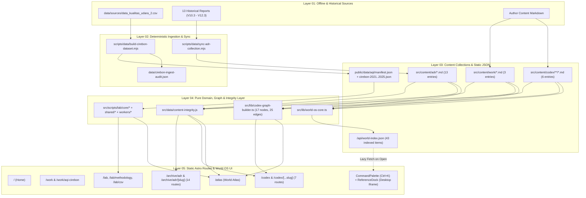

# V13.0 IMPLEMENTATION REPORT - THE LIVING ARCHIVE (HARDENED EDITION)

**Proyek:** `portfolio-astro` (Farrel / FIP)  
**Target Rilis:** V13.0-HARDENED ("The Living Archive: Engineering Records, Selective TypeScript, Grand Codex 100-600, World OS, and World Atlas")  
**Baseline Masuk:** V12.3 (Verified Zero-Debt Baseline)  
**Tanggal Penyelesaian:** 4 November 2026  
**Verdict Akhir:** `PASS WITH DOCUMENTED LIMITATIONS` (Seluruh 14 mandatory gates, 7 test runner dengan 176 total blok pengujian, cross-runtime Node.js/Python ETL digest, dan production build 34 halaman statis + `/api/world-index.json` lulus dengan exit code `0`; pemeriksaan visual interaktif browser penuh dicatat secara jujur sebagai keterbatasan lingkungan CLI sandbox dan diverifikasi melalui inspeksi DOM/HTML/CSS terkompilasi serta unit/integration test).

---

## 1. Executive Summary

Pembaruan **V13.0-HARDENED ("The Living Archive")** memperluas `portfolio-astro` dari arsip portofolio dan laboratorium data V12.3 menjadi sistem pengetahuan rekayasa terintegrasi yang terdiri dari lima pilar arsitektural:

1. **Fase A - The Engineering Records Vault (`/archive/adr` & `/archive/adr/[slug]`):** Mengubah 13 dokumen arsitektur, diagnostik, eksperimen, dan implementasi historis (`V10.3` hingga `V12.3`) menjadi koleksi tervalidasi `adr` pada Astro Content Layer (`src/content/adr/*.md`). Seluruh 13 dokumen sumber asli di root repositori dipertahankan utuh 100% byte-per-byte (terbukti melalui verifikasi SHA-256), sementara salinan koleksi dinormalisasi secara deterministik melalui `scripts/data/sync-adr-collection.mjs` untuk menghilangkan karakter `U+2014` (`em-dash`) tanpa menyentuh angka, rumus, tabel, atau blok kode.
2. **Fase B - Selective TypeScript Hardening (`src/types/*.ts` & `// @ts-check`):** Menambahkan kontrak tipe domain eksplisit (`src/types/lab-aqi.ts`, `src/types/lab-csv.ts`, `src/types/core-lifecycle.ts`) dan anotasi JSDoc `// @ts-check` pada seluruh modul perhitungan ISPU P.14/2020, statistik, parser CSV, analisis CSV, Web Worker CSV, validator integritas, serta lifecycle core. Strategi ini mempertahankan kompatibilitas eksekusi langsung pada Node.js (`v24.18.0`) tanpa langkah transpilasi tambahan dan menjaga paritas numerik 100% terhadap *golden baseline* (`v13-work/baseline/phase-b-golden-parity.json`).
3. **Fase C - The Grand Codex 100-600 (`/codex` & `/codex/[...slug]`):** Membangun sistem catatan teknis berbasis klasifikasi desimal `100-600` (`src/content/codex/**/*.md`) dengan 6 catatan fondasi yang terikat pada bukti kode sumber nyata (`sourceFiles` dan `sourceEvidence`), perenderan rumus matematika menggunakan **native MathML statis** beserta fallback notasi sumber tanpa dependensi runtime eksternal (tanpa KaTeX/MathJax), serta builder graf pengetahuan deterministik (`src/lib/codex-graph-builder.ts`) dengan daftar alternatif aksesibel keyboard (`#codex-graph-accessible-list`) dan penghentian simulasi fisika penuh pada mode `prefers-reduced-motion: reduce`.
4. **Fase D - World OS Layer (`CommandPalette`, `ReferenceDock`, & `/api/world-index.json`):** Menambahkan antarmuka navigasi keyboard global (`Ctrl+K` / `Cmd+K`) yang memuat indeks `/api/world-index.json` secara *lazy* hanya saat dialog dibuka (0 request jaringan tambahan pada pemuatan awal halaman), parser perintah berbasis allowlist (`:warp`, `:split`, `:audio`, `:top`), indikator status workspace yang jujur di header (`#world-workspace-status-btn`), serta panel referensi samping desktop (`ReferenceDock`, `>= 1024px`) menggunakan `<iframe sandbox="" referrerpolicy="same-origin">` tanpa izin eksekusi skrip dan tanpa memindahkan elemen `<main id="main">`.
5. **Fase E - Progressive World Atlas, ETL Contract & Master Zero-Debt Audit (`/atlas`, `scripts/data/README.md`, `scripts/audit-v13-zero-debt.mjs`):** Membangun peta topologi sistem build-time (`/atlas`) yang memetakan 7 sektor arsitektur beserta metrik nyata yang dihitung dari koleksi dan dataset pada waktu build, mendokumentasikan kontrak interoperabilitas ETL Node.js + Python 3 (`scripts/data/README.md` & `scripts/data/etl-interop-fixture.json`), serta mengonsolidasikan 14 gerbang kualitas ke dalam `scripts/audit-v13-zero-debt.mjs`.

---

## 2. Arsitektur V13.0 yang Terimplementasi

Arsitektur V13.0 mematuhi prinsip *Single Source of Truth* dan *Additive Integration*:

- **Astro Content Layer (`src/content.config.ts`):** Mengelola tiga koleksi tervalidasi Zod (`work` [3 entri], `adr` [13 entri], dan `codex` [6 entri]). Koleksi `work` tidak dimigrasi ulang dan tetap menggunakan `entry.id` untuk rute serta `data.contentId` untuk relasi.
- **Cross-Collection Integrity Validator (`src/data/content-integrity.js`):** Diperluas secara aditif dengan `validateAdrCollection`, `validateCodexCollection`, `validateCrossCollectionIntegrity`, dan `assertV13ContentIntegrity`. Validator ini dijalankan baik oleh test runner Node maupun saat build Astro (`src/pages/archive/adr/index.astro`, `src/pages/codex/index.astro`, `src/pages/atlas/index.astro`, dan `src/pages/api/world-index.json.ts`).
- **Single-Owner Client Lifecycle (`src/scripts/core.js`, `src/scripts/core/page-lifecycle.js`, `src/scripts/core/motion-registry.js`):** Seluruh modul interaktif baru (`src/scripts/archive/adr.js`, `src/scripts/codex.js`, `src/scripts/global/command-palette.ts`, `src/scripts/global/tiling-dock.ts`) mendaftarkan listener, observer, dan fungsi pembersihannya melalui `bootPage()` dan `trackMotionListener()` sehingga aman terhadap transisi halaman Astro (`ClientRouter` / `astro:after-swap`).
- **Protected Systems Isolation:** Sistem pembuka non-modal (`Curtain.astro`, `curtain.css`, `curtain-controller.js`), sistem kanvas WebGL (`HeroCanvas.astro`, `src/scripts/hero-webgl/*`), dan berkas markdown koleksi `work` (`src/content/work/*.md`) tidak disentuh sama sekali.

---

## 3. Diagram Route dan Hubungan Antar-Koleksi

---

## 4. Inventaris File (Created / Modified / Deleted / Unchanged-Protected)

Tidak ada satu pun file yang dihapus (`Deleted: 0`) selama eksekusi V13.0. Tabel berikut mengikuti format **Bagian 6.3**:

| Path | Action | Alasan | Risiko | Test terkait | Snapshot / Current SHA-256 |
|---|---|---|---|---|---|
| `src/lib/adr-taxonomy.ts` | Created (Fase A) | Manifest kanonis 13 ADR, taksonomi kategori/status, dan helper provenance | Low | `test-v13-adr.mjs` | `f4ad0b8d2fcdd017c6e3c2cbe68febfadf6fc0506611ae8915ae828da7cd3199` |
| `scripts/data/sync-adr-collection.mjs` | Created (Fase A) | Generator deterministik `src/content/adr/*.md` dengan verifikasi SHA-256 byte sumber asli & normalisasi `U+2014` pada salinan | Low | `test-v13-adr.mjs` | `b39190cb2e583294dca7feea232b87c53fcabb5c0a433caa82f27bb3c0d804b4` |
| `src/content/adr/*.md` (13 files) | Created (Fase A) | Entri koleksi `adr` tervalidasi dari `V10.3` s.d. `V12.3` | Low | `test-v13-adr.mjs` | Verified via `sync-adr-collection.mjs --check` |
| `src/pages/archive/adr/index.astro` | Created (Fase A) | Halaman indeks Engineering Records Vault (`/archive/adr`) | Low | `test-v13-adr.mjs` | `23dfe015255aebca1142ea3563337f91ada9568a3eafda02af6700b03b9af65e` |
| `src/pages/archive/adr/[slug].astro` | Created (Fase A) | Halaman detail 13 Engineering Records dengan panel provenance SHA-256 | Low | `test-v13-adr.mjs` | `31d36be7d0cebfa293b1db865bdb5cb80eb3d81807d0be33e67b71cb463c1cdd` |
| `src/scripts/archive/adr.js` | Created (Fase A) | Filter klien progresif `/archive/adr` yang terdaftar pada `bootPage()` | Low | `test-v13-adr.mjs` | `11b9ac0d4fed8a617e897d37cba207de96650a30fa1a8fc19bd94b46214a53a0` |
| `src/styles/archive/adr.css` | Created (Fase A) | Stylesheet responsif `/archive/adr` dengan lokal tabel overflow | Low | `test-v13-adr.mjs` | `4606312fab19814e54ad3cee08f165acc376dc7a98055a4833ffe204d6c7af98` |
| `src/types/lab-aqi.ts` | Created (Fase B) | Kontrak tipe TypeScript domain ISPU P.14/2020, dataset Cirebon, dan statistik | Low | `test-v13-ts-parity.mjs` | `8a04bcd818d691fcb9fcd9710cc952a9a120a6119ff4979777a1fe0f408260cc` |
| `src/types/lab-csv.ts` | Created (Fase B) | Kontrak tipe TypeScript domain CSV parser, CSV analysis, dan protokol Worker | Low | `test-v13-ts-parity.mjs` | `fb790c54b45206a296cf343a6048fb4f2e2155bb7fc13a83bf6c51872f5f9c99` |
| `src/types/core-lifecycle.ts` | Created (Fase B) | Kontrak tipe TypeScript untuk `bootPage()` dan `motionRegistry` | Low | `test-v13-ts-parity.mjs` | `bcfdc74b8181531957d046e1020c42723470bf4f3b82ba18405ebb855ff4d54f` |
| `src/scripts/lab/core/aqi-calculator.js` | Modified (Fase B) | Penambahan `// @ts-check` dan anotasi tipe JSDoc tanpa mengubah logika bisnis | Low | `test-lab-core.mjs`, `test-v13-ts-parity.mjs` | `c5fffef8c4f8a261...` (Snapshot: `047221ceadd8e117...`) |
| `src/scripts/lab/core/validate-dataset.js` | Modified (Fase B) | Penambahan `// @ts-check` dan anotasi tipe JSDoc | Low | `test-lab-core.mjs`, `test-v13-ts-parity.mjs` | `674fcc2be979409d...` (Snapshot: `791d3f9375355f22...`) |
| `src/scripts/lab/shared/stats.js` | Modified (Fase B) | Penambahan `// @ts-check` dan anotasi tipe JSDoc | Low | `test-lab-core.mjs`, `test-v13-ts-parity.mjs` | `5b354b11d0c35417c9c2cbcf9d589505b3ab6d536c93e9d6fcf1faa5f81df173` |
| `src/scripts/lab/shared/csv-parser.js` | Modified (Fase B) | Penambahan `// @ts-check` dan anotasi tipe JSDoc | Low | `test-csv-explorer.mjs`, `test-v13-ts-parity.mjs` | `464e5e3ee14a0dc5076158a7ebd2ea4d779ec85d57bcd4ef0d0219f61a404bc8` |
| `src/scripts/lab/shared/csv-analysis.js` | Modified (Fase B) | Penambahan `// @ts-check` dan anotasi tipe JSDoc | Low | `test-csv-explorer.mjs`, `test-v13-ts-parity.mjs` | `f18cdf740e8fcdbd6474b417b5a10e206d1538c1d1006ab168313bf276286ff1` |
| `src/scripts/lab/workers/csv-worker.js` | Modified (Fase B) | Penambahan `// @ts-check` dan anotasi tipe JSDoc protokol pesan Worker | Low | `test-csv-explorer.mjs`, `test-v13-ts-parity.mjs` | `39dccc55bef39b87be0728479274cc3462257355a517dd85524ab88362aa5644` |
| `src/scripts/core/page-lifecycle.js` | Modified (Fase B) | Penambahan `// @ts-check` dan kontrak `BootPageConfig` | Low | `test-v13-ts-parity.mjs` | `969378112924b4ee...` (Snapshot: `706d844eb3210fe5...`) |
| `src/scripts/core/motion-registry.js` | Modified (Fase B) | Penambahan `// @ts-check` dan kontrak cleanup registry | Low | `test-v13-ts-parity.mjs` | `6446d9467d4878d8...` (Snapshot: `a2d9a8b25d3a3f59...`) |
| `src/lib/codex-taxonomy.ts` | Created (Fase C) | Definisi kanonis 6 domain desimal `100-600`, tingkat kematangan (`SEEDLING`, `BUDDING`, `EVERGREEN`), dan status bukti | Low | `test-v13-codex.mjs` | `5fae8dff696c67f76d87eb887803f97c183b3be5f36d8a62ecb819153534ce5b` |
| `src/lib/codex-graph-builder.ts` | Created (Fase C) | Builder graf pengetahuan build-time deterministik, deduplikasi edge, inverse backlinks, dan batas simulasi | Low | `test-v13-codex.mjs` | `0b16abe013cdb88a78244b0b8e6c6da5b6b5146d2b683819ab543f51b14c16d4` |
| `src/content/codex/**/*.md` (6 files) | Created (Fase C) | Enam catatan fondasi Codex `101.1`, `201.1`, `301.1`, `401.1`, `501.1`, `601.1` | Low | `test-v13-codex.mjs` | Verified via `test-v13-codex.mjs` |
| `src/pages/codex/index.astro` | Created (Fase C) | Halaman indeks `/codex` dengan kanvas graf pengetahuan + daftar alternatif aksesibel | Low | `test-v13-codex.mjs` | `9879294240173841b9945035b3641eea349ecbf01f407ec992009a47aaf328f1` |
| `src/pages/codex/[...slug].astro` | Created (Fase C) | Halaman detail catatan Codex dengan MathML statis, matriks bukti, dan panel backlinks | Low | `test-v13-codex.mjs` | `1e695cee8c3f0882107a6dee0a2952e80d0aa50e191f5628c4ce61234e968d2b` |
| `src/scripts/codex.js` | Created (Fase C) | Filter klien `/codex` dan perender kanvas 2D berbatas yang patuh `isReducedMotion()` | Low | `test-v13-codex.mjs` | `d3f16f9593bf22e5ff8677c72cac1f114d7a44d463e44faa43e16a8d9982797c` |
| `src/styles/codex.css` | Created (Fase C) | Stylesheet `/codex` dan detail catatan dengan dukungan MathML & tabel responsif | Low | `test-v13-codex.mjs` | `14634b86681a5e2837baef8c345867072c48dc2da59d0b753bc2fa4859a68a43` |
| `src/lib/world-os-core.ts` | Created (Fase D) | Logika murni World OS: 14 territory, command allowlist, 5-tier search ranking, dan validator URL Dock | Low | `test-v13-world-os.mjs` | `64e2f652f358106d8efe256a01a7f844ac002cd39aa3784ded537c03a09240ce` |
| `src/pages/api/world-index.json.ts` | Created (Fase D) | Endpoint statis build-time `/api/world-index.json` | Low | `test-v13-world-os.mjs` | `fdd0e3312e875726d01e019907f67a6b3d1bae2316509ef96077ca5a40690de1` |
| `src/components/layout/CommandPalette.astro` | Created (Fase D) | Markup dialog Command Palette aksesibel (`role="combobox"`, `role="listbox"`) | Low | `test-v13-world-os.mjs` | `4571b732aae2688557774f0d47766154e6ea61b0e34e6c70316eacf519d363a0` |
| `src/components/layout/ReferenceDock.astro` | Created (Fase D) | Markup `<aside id="world-reference-dock">` dengan `<iframe sandbox="">` | Low | `test-v13-world-os.mjs` | `27272c21e9cada83de5c26cc060b6452ebd4e8dd551d4cd7ab14f60156665197` |
| `src/scripts/global/command-palette.ts` | Created (Fase D) | Controller Command Palette dengan lazy fetch dan safe DOM (`createElement`/`textContent`) | Low | `test-v13-world-os.mjs` | `59df68e28fa66c47c5c9526dceead92a11be6a01dd689cba3da7fbf80d8c60da` |
| `src/scripts/global/tiling-dock.ts` | Created (Fase D) | Controller Reference Dock desktop (`>= 1024px`) dengan validasi URL same-origin | Low | `test-v13-world-os.mjs` | `93c2004ddffef79e9d287e2c4f21e3ed4a1f26728e09f5699cfc96855c4a1252` |
| `src/styles/global/command-palette.css` | Created (Fase D) | Stylesheet Command Palette & tombol status workspace di header | Low | `test-v13-world-os.mjs` | `4bbe152af74117fec8f2b5cda91ea44fdd48bedaa1bc1a12b1dad13ebd2eaeef` |
| `src/styles/global/tiling-dock.css` | Created (Fase D) | Stylesheet Reference Dock desktop (`@media (min-width: 1024px)`) | Low | `test-v13-world-os.mjs` | `4d56da3f8edda3d253cea75b17d0fe96a8fa3d32c3a5be1736b53dc16f0fe3c2` |
| `src/pages/atlas/index.astro` | Created (Fase E) | Halaman `/atlas` (7 sektor, metrik build-time nyata, Subsektor 3A/3B/3C, SVG + tabel topologi) | Low | `audit-v13-zero-debt.mjs` | `90d0926d2c07b58dbcc895713cd60f2dbce97f9b9d1671ae80523c96774e591c` |
| `src/styles/atlas.css` | Created (Fase E) | Stylesheet `/atlas` dengan grid responsif dan lokal tabel overflow | Low | `audit-v13-zero-debt.mjs` | `db8c242ed2180f95c3bada1c2a6dc27b095a47b47b18612b23342e990d7839c1` |
| `scripts/data/README.md` | Created (Fase E) | Dokumentasi kontrak ETL Cirebon, provenance SHA-256, dan interoperabilitas Node.js + Python 3 | Low | `audit-v13-zero-debt.mjs` | `182cff44f5ad3fe54f4d39b1d1d049ffeb61d95352920db31fc1e8aba84dda11` |
| `scripts/data/etl-interop-fixture.json` | Created (Fase E) | Fixture uji kanonikalisasi JSON lintas-runtime Node.js dan Python 3 | Low | `audit-v13-zero-debt.mjs` | `59c89a13ed1dfdbf3d45cc84714a30b43a67153e8691a58f80c76e69f0ae38f5` |
| `src/content.config.ts` | Modified (Fase A, C) | Penambahan koleksi `adr` dan `codex` secara aditif di samping `work` | Low | `test-content-integrity.mjs` | `486b3a0922037519...` (Snapshot: `4a15b80ef5fd1a41...`) |
| `src/data/content-integrity.js` | Modified (Fase A, B, C) | Penambahan validator koleksi `adr`, `codex`, dan relasi lintas-koleksi | Low | `test-content-integrity.mjs` | `c9d6316a61e051ad...` (Snapshot: `35550fd459a9c32d...`) |
| `src/data/content.js` | Modified (Fase A, C, E) | Penambahan entri navigasi `/archive/adr`, `/codex`, dan `/atlas` | Low | `test-v13-world-os.mjs` | `e93a8c6a20b24708...` (Snapshot: `9981c5103160fa56...`) |
| `src/pages/archive/index.astro` | Modified (Fase A, C, E) | Penambahan kartu direktori menuju `/archive/adr`, `/codex`, dan `/atlas` | Low | `test-v13-world-os.mjs` | `f41e724db2bbdb4d...` (Snapshot: `8d81709774c84fae...`) |
| `src/scripts/home/archive-search.js` | Modified (Fase A, C, E) | Penambahan indeks pencarian statis untuk ADR Vault, Grand Codex, dan World Atlas | Low | `test-v13-world-os.mjs` | `18c22697b85bf944...` (Snapshot: `82fb0d216b7773c2...`) |
| `src/components/layout/Header.astro` | Modified (Fase D) | Penambahan tombol `#world-workspace-status-btn` dan tautan Deep Dive `/codex` & `/atlas` | Low | `test-v13-world-os.mjs` | `3cdc2442f73f0f01...` (Snapshot: `50cb7f8517ce24b5...`) |
| `src/layouts/BaseLayout.astro` | Modified (Fase D) | Pemasangan `<ReferenceDock />` dan `<CommandPalette />` tanpa mengubah struktur `<main id="main">` | Low | `test-v13-world-os.mjs` | `12f03d0733893f84...` (Snapshot: `081af75752ff87be...`) |
| `src/styles/global.css` | Modified (Fase D) | Import `global/command-palette.css` dan `global/tiling-dock.css` | Low | `test-v13-world-os.mjs` | `cb4305fc6df6611e...` |
| `src/scripts/global.js` | Modified (Fase D) | Registrasi `initCommandPalette`, `initReferenceDock`, dan cleanup `closeReferenceDock` pada `bootPage()` | Low | `test-v13-world-os.mjs` | `676243fc83f4906d...` |
| `scripts/test-content-integrity.mjs` | Modified (Fase A) | Penambahan pengujian integritas lintas-koleksi | Low | `test-content-integrity.mjs` | `8eadaa704a14e54be8c7cdad43708d8bb1cb5f6be6077e1c2de3cc285d127b37` |
| `scripts/test-v13-adr.mjs` | Created (Fase A) | Suite pengujian 16 kriteria Engineering Records Vault | Low | `GATE-14` | `ebd7fc07bbfdf5ff94afd3d822fd47643b57bb1845e1d15c0b6d52ce92365ad9` |
| `scripts/test-v13-ts-parity.mjs` | Created (Fase B) | Suite pengujian paritas numerik keemasan & typecheck `tsc --noEmit` | Low | `GATE-06`, `GATE-14` | `50044f640a0231b04ec84630d47bf2684c890ff89cc5b142a3735fbf1072b716` |
| `scripts/test-v13-codex.mjs` | Created (Fase C) | Suite pengujian 16 kriteria Grand Codex 100-600 & Knowledge Graph | Low | `GATE-04`, `GATE-14` | `03f404c0086d33c931fd81221e3c60d80e5ace27d33be34c54e8305c0d562e3e` |
| `scripts/test-v13-world-os.mjs` | Created (Fase D) | Suite pengujian 17 kriteria World OS, Command Palette, & Reference Dock | Low | `GATE-08`, `GATE-14` | `982d84876a7eafeac517a5fa9578c53c8c6369fefb2dae12918d32dc8b9773d3` |
| `scripts/audit-v13-zero-debt.mjs` | Created (Fase E) | Orchestrator audit 14 gerbang kualitas V13.0 | Low | `GATE-01..14` | `6f0c31c795e9816cee9bf20f9c6e3aaf606d7dd70bd8d9e16be19e73decbed2d` |
| `src/components/home/Curtain.astro` (+ `curtain.css`, `curtain-controller.js`) | Unchanged-Protected | Sistem pembuka non-modal yang dilindungi Hukum 8 | None | `GATE-01` | Identik 100% dengan baseline (`4b88ceae...`, `036e835f...`, `50bd7f96...`) |
| `src/components/home/HeroCanvas.astro` (+ `src/scripts/hero-webgl/*`) | Unchanged-Protected | Sistem Signature Hero WebGL yang dilindungi Hukum 8 | None | `GATE-01` | Identik 100% dengan baseline (`43700251...`, `2105fb72...`, dst.) |
| `src/content/work/*.md` (3 files) | Unchanged-Protected | Koleksi studi kasus existing yang dilindungi Hukum 8 | None | `GATE-01` | Identik 100% dengan baseline (`8b6bd3b6...`, `75ae96ec...`, `70c8bff2...`) |

---

## 5. ADR Inventory, Source Hashes, Provenance, dan Status

Seluruh 13 dokumen rekayasa historis disinkronkan melalui `scripts/data/sync-adr-collection.mjs` dengan mempertahankan status verifikasi `reported` (sebagai rekaman historis pada saat versi terkait dirilis, dibedakan secara eksplisit dari `verified-current`):

| Seq | ADR ID | Version Tag | Slug (`/archive/adr/[slug]`) | Source Filename | Source Bytes | Source SHA-256 (Raw Unmodified) | Em-Dash Normalized in Copy | Status |
|---:|---|---|---|---|---:|---|---:|---|
| 1 | `adr-001-v10-3-performance-baseline` | `V10.3` | `v10-3-performance-baseline` | `PERFORMANCE_BASELINE.md` | 6.980 | `33ee8e699eae486c6d9ce3fec5c5e99b33758ae106ce31dfe6adaa6ab4c9ae9b` | 15 | `HISTORICAL_RECORD` (`reported`) |
| 2 | `adr-002-v10-3-identity-audit` | `V10.3` | `v10-3-identity-audit` | `IDENTITY_AUDIT.md` | 9.666 | `ad74093430d5353ad6ff79cce58180bb9c6bd460d29cc8bb43f74f8ec67735e5` | 29 | `HISTORICAL_RECORD` (`reported`) |
| 3 | `adr-003-v10-4-diagnostic-report` | `V10.4` | `v10-4-diagnostic-report` | `V10.4_DIAGNOSTIC_REPORT.md` | 18.997 | `6ac1ca6bdbd910e6716455accc3d67a442cc3675a8e81f0663e9773a568d4589` | 0 | `SUPERSEDED_BY_LATER_PHASE` (`reported`) |
| 4 | `adr-004-v10-5-experiment-report` | `V10.5` | `v10-5-experiment-report` | `V10.5_EXPERIMENT_REPORT.md` | 23.622 | `fb1e25ac8032954fa657ade4edf9d429c3b754e10bc4774f11b7f372fb1c4ab9` | 66 | `HISTORICAL_RECORD` (`reported`) |
| 5 | `adr-005-v10-5-final-decision` | `V10.5` | `v10-5-final-decision` | `V10.5_FINAL_DECISION.md` | 1.838 | `b694d5228027b839d3be154fe0b2e5de33c5fc0b6cabd368f43e1f821483a2d3` | 7 | `ACTIVE_CONTRACT` (`reported`) |
| 6 | `adr-006-v10-5-final-verification` | `V10.5` | `v10-5-final-verification` | `V10.5_FINAL_VERIFICATION.txt` | 433 | `681f9f76959482b7cff26d64cee7c7efa5e6aa380e0c272d6e4920192c1a0a09` | 0 | `VERIFIED_BASELINE` (`reported`) |
| 7 | `adr-007-v11-0-implementation-report` | `V11.0` | `v11-0-implementation-report` | `V11.0_IMPLEMENTATION_REPORT.md` | 22.370 | `c0775bb61e1ff525d69e14e9f109196942c5cfcc47474d7cb58a45af63181f23` | 39 | `ACTIVE_CONTRACT` (`reported`) |
| 8 | `adr-008-v11-1-implementation-report` | `V11.1` | `v11-1-implementation-report` | `V11.1_IMPLEMENTATION_REPORT.md` | 22.247 | `b131149621e410500bea6239fa6994802627ef7a9adb363d0157f90d35dfca2f` | 59 | `ACTIVE_CONTRACT` (`reported`) |
| 9 | `adr-009-v11-1-modularization-report` | `V11.1-M` | `v11-1-modularization-report` | `V11.1_MODULARIZATION_REPORT.md` | 25.562 | `c9d7131c84bc0c84565926528084db89a5ba0c766092e5139ecdef7342386488` | 27 | `ACTIVE_CONTRACT` (`reported`) |
| 10 | `adr-010-v12-0-implementation-report` | `V12.0` | `v12-0-implementation-report` | `V12.0_IMPLEMENTATION_REPORT.md` | 26.406 | `0df55b1d72f6905fd0b6949fe92f960c06fe4e16b6cac817f0230092203314f0` | 0 | `ACTIVE_CONTRACT` (`reported`) |
| 11 | `adr-011-v12-0-audit-closure-report` | `V12.0-AC` | `v12-0-audit-closure-report` | `V12.0_AUDIT_CLOSURE_REPORT.md` | 21.651 | `bd3f5bbac623ddf2050c85975ae7e19a8736471b287a74cd9afd51e356cc1b33` | 0 | `VERIFIED_BASELINE` (`reported`) |
| 12 | `adr-012-v12-2-implementation-report` | `V12.2` | `v12-2-implementation-report` | `V12.2_IMPLEMENTATION_REPORT.md` | 22.919 | `113ced6df4d813b84bbda85f155e111e524d0ed39433828687c9160240e8a0c5` | 33 | `ACTIVE_CONTRACT` (`reported`) |
| 13 | `adr-013-v12-3-implementation-report` | `V12.3` | `v12-3-implementation-report` | `V12.3_IMPLEMENTATION_REPORT.md` | 26.227 | `e3dac4d9b8fe9560c043d618de3905606a7db321987e5a981468c30fff0719f0` | 0 | `VERIFIED_BASELINE` (`reported`) |

---

## 6. TypeScript Migration Matrix, Compiler Versions, dan Kompatibilitas Node

- **Runtime Node.js Aktual:** `v24.18.0` (mendukung native type-stripping untuk `.ts` murni dan eksekusi langsung `.js` beranotasi `// @ts-check`).
- **TypeScript Compiler:** `typescript@5.9.3` (tersedia di `node_modules/.bin/tsc`).
- **Strategi Migrasi:**
  - Modul domain baru V13.0 (`src/lib/adr-taxonomy.ts`, `src/lib/codex-taxonomy.ts`, `src/lib/codex-graph-builder.ts`, `src/lib/world-os-core.ts`, `src/scripts/global/command-palette.ts`, `src/scripts/global/tiling-dock.ts`) ditulis dalam **TypeScript murni (`.ts`)** yang kompatibel dengan Node type-stripping (tanpa `enum` runtime atau `namespace`).
  - Modul perhitungan Lab & Core yang sudah diimpor oleh test runner `.mjs` (`aqi-calculator.js`, `validate-dataset.js`, `stats.js`, `csv-parser.js`, `csv-analysis.js`, `csv-worker.js`, `page-lifecycle.js`, `motion-registry.js`, `content-integrity.js`) diperkeras dengan **`// @ts-check`** + definisi tipe terpusat di `src/types/lab-aqi.ts`, `src/types/lab-csv.ts`, dan `src/types/core-lifecycle.ts`.
  - Pemeriksaan `npx tsc --noEmit` berjalan bersih dengan **0 diagnostik error** dan keluar dengan kode `0`.
  - Paritas numerik terhadap `v13-work/baseline/phase-b-golden-parity.json` (SHA-256: `c31c1b97ce18b84107e4fad9f96de6947d0b92e46446582ea742469f7ffdbb98`) terbukti **100% identik (0 deviasi)**.

---

## 7. Codex Inventory, Domain Distribution, Source Evidence, Maturity, dan Backlinks

Koleksi `codex` memiliki 6 catatan fondasi yang mewakili keenam domain desimal `100-600`:

| Decimal Code | Codex ID | Domain | Maturity | Route (`/codex/[...slug]`) | Formulas (Static MathML) | Outgoing Relations | Incoming Backlinks |
|---|---|---|---|---|---:|---:|---:|
| `101.1` | `codex-101-single-owner-lifecycle-and-motion-registry` | `100-software-and-systems` | `EVERGREEN` | `/codex/100-software-and-systems/101-single-owner-lifecycle-and-motion-registry` | 0 | 5 (`201`, `401`, `601`, `adr-009`, `adr-011`) | 3 (`201`, `401`, `601`) |
| `201.1` | `codex-201-finite-state-csv-parsing-and-worker-isolation` | `200-data-and-computation` | `EVERGREEN` | `/codex/200-data-and-computation/201-finite-state-csv-parsing-and-worker-isolation` | 1 (`sample-stride`) | 5 (`101`, `301`, `501`, `adr-012`, `adr-013`) | 3 (`101`, `301`, `501`) |
| `301.1` | `codex-301-equity-data-structure-and-observational-limits` | `300-quant-and-markets` | `SEEDLING` | `/codex/300-quant-and-markets/301-equity-data-structure-and-observational-limits` | 1 (`log-return`) | 4 (`201`, `501`, `work:saham-indonesia` [RESERVED], `adr-012`) | 1 (`201`) |
| `401.1` | `codex-401-fresnel-glass-vessel-and-svg-first-fallback` | `400-graphics-and-rendering` | `BUDDING` | `/codex/400-graphics-and-rendering/401-fresnel-glass-vessel-and-svg-first-fallback` | 1 (`fresnel-schlick`) | 4 (`101`, `601`, `adr-008`, `adr-011`) | 2 (`101`, `601`) |
| `501.1` | `codex-501-ispu-p14-2020-linear-interpolation-and-time-basis` | `500-environment-and-regulations` | `EVERGREEN` | `/codex/500-environment-and-regulations/501-ispu-p14-2020-linear-interpolation-and-time-basis` | 1 (`ispu-linear`) | 5 (`201`, `301`, `work:aqi-cirebon`, `adr-010`, `adr-011`) | 2 (`201`, `301`) |
| `601.1` | `codex-601-non-modal-curtain-and-typographic-hierarchy` | `600-editorial-and-design` | `BUDDING` | `/codex/600-editorial-and-design/601-non-modal-curtain-and-typographic-hierarchy` | 0 | 5 (`101`, `401`, `adr-005`, `adr-007`, `adr-013`) | 2 (`101`, `401`) |

- **Distribusi Maturity:** 3 `EVERGREEN` (`101.1`, `201.1`, `501.1`), 2 `BUDDING` (`401.1`, `601.1`), dan 1 `SEEDLING` (`301.1`, karena studi pasar modal Indonesia masih berstatus `RESERVED`).
- **Penanganan Reference-Only Node:** Relasi `301.1 -> work:saham-indonesia` dirender sebagai badge `REFERENCE ONLY (RESERVED)` tanpa `<a href="...">`, sehingga tidak pernah menghasilkan tautan mati (`404`).

---

## 8. Graph Implementation, Node/Edge Count, Performance Cap, dan Reduced-Motion Behavior

- **Statistik Graf Aktual (`buildCodexKnowledgeGraph`):**
  - **Total Simpul (`nodes`):** `17` simpul (`6` Codex notes, `2` Work items yang direferensikan [`work:aqi-cirebon` dan `work:saham-indonesia`], serta `9` ADR records yang direferensikan).
  - **Total Sisi (`edges`):** `25` sisi berarah yang telah dideduplikasi (`13` `related-codex`, `2` `related-work`, `10` `related-adr`).
  - **Reference-Only Nodes:** `1` (`work:saham-indonesia`, `url: null`, `routeable: false`).
- **Batas Skala & Kinerja (`GRAPH_SCALE_LIMITS`):**
  - `MAX_SPRING_NODES = 200`, `MAX_SPRING_EDGES = 400`, `MAX_SPRING_ITERATIONS = 120`, `DAMPING = 0.82`, `ENERGY_THRESHOLD = 0.0015`.
  - Apabila jumlah simpul melebihi `200` atau sisi melebihi `400`, `computeBoundedGraphLayout()` otomatis beralih ke `large-graph-clustered` (`O(N)` deterministik tanpa menghitung gaya tolak `O(N^2)` antar-pasangan simpul).
- **Perilaku Reduced-Motion:**
  - Ketika `prefers-reduced-motion: reduce` aktif (`isReducedMotion() === true`), `computeBoundedGraphLayout()` menjalankan **0 iterasi fisika spring** dan `src/scripts/codex.js` hanya melakukan satu kali gambar statis pada kanvas (`0` pemanggilan `requestAnimationFrame`).
- **Alternatif Aksesibel:**
  - Setiap simpul dan relasi pada kanvas memiliki representasi daftar HTML semantik yang dapat dinavigasi dengan keyboard di `#codex-graph-accessible-list`.

---

## 9. World OS Behavior, Command List, Lazy Fetch Proof, dan Iframe Sandbox Config

- **Lazy Fetch `/api/world-index.json`:**
  - Fungsi `ensureWorldIndexLoaded()` di `src/scripts/global/command-palette.ts` hanya dipanggil di dalam `openPalette()` atau saat perintah dijalankan oleh pengguna. Pada saat halaman pertama kali dimuat (`initCommandPalette()`), **tidak ada pemanggilan `fetch()`** ke `/api/world-index.json`. Hasil tangkapan disimpan dalam variabel modul `cachedIndexPayload` selama sesi dokumen.
- **Daftar Perintah Allowlist (`WORLD_COMMANDS`):**
  1. `:warp <territory>` - Navigasi langsung ke wilayah terdaftar (contoh: `:warp codex`, `:warp lab`, `:warp atlas`).
  2. `:split open [path]` - Membuka Reference Tiling Dock pada layar desktop (`>= 1024px`).
  3. `:split close` - Menutup Reference Tiling Dock.
  4. `:audio mute` / `:audio unmute` / `:audio toggle` - Mengubah status audio antarmuka melalui state asli `audio-runtime.js` (`setAudioMuted`) dan menyinkronkan atribut `aria-pressed` pada `#audio-toggle`.
  5. `:top` - Menggulir kembali ke puncak halaman aktif melalui `scrollToTarget(0)`.
- **Keamanan Reference Tiling Dock (`src/scripts/global/tiling-dock.ts`):**
  - Menggunakan `<aside id="world-reference-dock">` yang berdampingan dengan `<main id="main">` pada layar `>= 1024px` tanpa pernah memindahkan node `<main>` di DOM.
  - Elemen `<iframe id="world-dock-iframe">` dikunci dengan atribut `sandbox=""` (tanpa `allow-scripts`, tanpa `allow-same-origin`, tanpa `allow-top-navigation`) dan `referrerpolicy="same-origin"`.
  - Fungsi `validateDockTargetUrl()` menolak seluruh URL eksternal (`https://`), protocol-relative (`//`), skema berbahaya (`javascript:`, `data:`), path traversal (`..`), backslash (`\`), parameter kueri/hash bebas (`?`, `#`), dan rute studi kasus yang masih `RESERVED` (`/work/saham-indonesia`).

---

## 10. Atlas Metrics dan Status Sector

Halaman `/atlas` (`src/pages/atlas/index.astro`) menghitung seluruh metrik secara langsung pada waktu build dari koleksi dan dataset aktual:

| Sector Code | Nama Sektor | Rute Utama | Status | Metrik Nyata Terhitung Saat Build |
|---|---|---|---|---|
| `SECTOR 01` | **The Citadel (Home & Identity)** | `/`, `/about`, `/connect` | `OPERATIONAL` | 3 rute identitas & orientasi; Curtain non-modal & SVG-first Hero Vessel |
| `SECTOR 02` | **Selected Work & Case Studies** | `/work`, `/work/aqi-cirebon` | `OPERATIONAL` | 3 entri koleksi `work`: 1 `IN PROGRESS` (routeable), 2 `RESERVED` (non-routeable) |
| `SECTOR 03` | **The Data Lab (AQI, Methodology & CSV)** | `/lab`, `/lab/methodology`, `/lab/csv` | `OPERATIONAL` | **3A AQI (`OPERATIONAL`):** 5 tahun (2021-2025), 57 titik pantau, 114 pengamatan parameter; **3B CSV (`OPERATIONAL`):** 10 MiB / 100 kolom / 100.000 baris / 500.000 sel; **3C Capital Markets (`RESERVED_BLUEPRINT`):** studi saham Indonesia belum memiliki dataset publik tervalidasi |
| `SECTOR 04` | **The Grand Codex (100-600)** | `/codex`, `/codex/[...slug]` | `OPERATIONAL` | 6 catatan fondasi (`100-600`), 4 formula MathML statis, 3 `EVERGREEN`, 2 `BUDDING`, 1 `SEEDLING` |
| `SECTOR 05` | **Engineering Records Vault (ADR)** | `/archive/adr`, `/archive/adr/[slug]` | `OPERATIONAL` | 13 rekaman arsitektur & diagnostik (`V10.3`-`V12.3`) dengan verifikasi SHA-256 penuh |
| `SECTOR 06` | **Archive & Extended Shelves** | `/archive`, `/archive/play`, `/archive/off-screen`, `/archive/credentials` | `OPERATIONAL` | 7 sub-rak direktori arsip terindeks |
| `SECTOR 07` | **World OS & Progressive Atlas** | `/atlas`, `/api/world-index.json` | `OPERATIONAL` | 14 territory kanonis, 5 grup perintah allowlist, 17 simpul & 25 sisi pada graf pengetahuan |

---

## 11. ETL Input/Output Contract dan Reproducibility Evidence

Kontrak pipeline offline didokumentasikan di `scripts/data/README.md` dan diuji dengan `scripts/data/etl-interop-fixture.json`:

- **Input Mentah Cirebon:** `data/sources/data_kualitas_udara_2.csv` (`3.524` byte, SHA-256: `9ce4de3d0466c71d1ce10447941236e9b7cfc19af255c6831fec89a5d25a31a0`). File ini bersifat read-only dan tidak pernah ditimpa oleh skrip ETL.
- **Audit Ingesti Cirebon:** `data/cirebon-ingest-audit.json` hanya memuat path relatif repositori (`data/sources/data_kualitas_udara_2.csv`), tanggal akses yang jujur (`2026-04-18`), dan 0 path absolut mesin lokal.
- **Bukti Reproduksibilitas Lintas-Runtime (Node.js `v24.18.0` vs Python `3.14.9`):**
  - Kanonikalisasi JSON (pengurutan kunci leksikografis rekursif, UTF-8 tanpa spasi pemisah, angka IEEE-754 standar) pada `scripts/data/etl-interop-fixture.json` menghasilkan digest SHA-256 yang **100% identik** di kedua bahasa:
  - **Node.js SHA-256:** `3039b01cd12ac0a647a69062467c225f81054a9769d63f130a8ef89821f29a23`
  - **Python 3 SHA-256:** `3039b01cd12ac0a647a69062467c225f81054a9769d63f130a8ef89821f29a23`

---

## 12. Tabel 14 Gate Master Zero-Debt Audit (`scripts/audit-v13-zero-debt.mjs`)

Tabel berikut mengikuti format **Bagian 6.2** untuk seluruh 14 gerbang kualitas pada `node scripts/audit-v13-zero-debt.mjs`:

| ID | Command / Check | Expected | Actual | Exit code | Result | Evidence |
|---|---|---|---|---:|---|---|
| GATE-01 | `node scripts/audit-v13-zero-debt.mjs` (Protected Feature Integrity) | 26 file protected & laporan historis cocok 100% dengan SHA-256 baseline | `26/26 protected & historical files match baseline SHA-256` | 0 | PASS | `v13-work/snapshots/phase-a/run-1/manifest.json` |
| GATE-02 | `node scripts/audit-v13-zero-debt.mjs` (Em-Dash Baseline Delta) | 0 `U+2014` pada seluruh file baru V13.0 & 0 peningkatan pada 63 file baseline | `0 U+2014 across 96 new V13.0 files; 0 net increases across 63 baseline files` | 0 | PASS | `v13-work/baseline/em-dash-baseline.json` |
| GATE-03 | `node scripts/audit-v13-zero-debt.mjs` (Editorial Anti-AI Voice) | 0 kata promosi terlarang pada teks konten & UI baru V13.0 | `0 blacklisted promotional words across 14 V13.0 editorial/UI files (30 terms scanned)` | 0 | PASS | `scripts/audit-v13-zero-debt.mjs` |
| GATE-04 | `node scripts/audit-v13-zero-debt.mjs` (Cross-Collection Integrity) | Koleksi `work` (3), `adr` (13), `codex` (6) & graf (17 simpul, 25 sisi) bebas relasi rusak; `saham-indonesia` non-routeable | `Validated 3 work, 13 adr, 6 codex entries; graph has 17 nodes & 25 edges; work:saham-indonesia url=null, routeable=false` | 0 | PASS | `src/data/content-integrity.js`, `src/lib/codex-graph-builder.ts` |
| GATE-05 | `node scripts/test-lab-core.mjs` (AQI Core Regression) | Seluruh assertion kalkulator ISPU P.14/2020 & validasi dataset lulus | `54 PASS, 0 FAIL` (periode referensi 24h & `allowBasisMismatch` terjaga) | 0 | PASS | `scripts/test-lab-core.mjs` |
| GATE-06 | `node scripts/test-csv-explorer.mjs` & `node scripts/test-v13-ts-parity.mjs` | Seluruh assertion CSV Explorer, batas keamanan, typecheck `tsc --noEmit`, & golden parity lulus | `test-csv-explorer.mjs (60 PASS, 0 FAIL) + test-v13-ts-parity.mjs (7 PASS, 0 FAIL)` | 0 | PASS | `v13-work/baseline/phase-b-golden-parity.json` |
| GATE-07 | `node scripts/data/sync-adr-collection.mjs --check` & Node/Python ETL Digest | 13 ADR provenance cocok, audit Cirebon bebas path absolut, SHA-256 Node == Python | `13 ADR hashes verified; raw CSV SHA-256=9ce4de3d0466...; Node/Python canonical JSON digest match (3039b01cd12ac0a6...)` | 0 | PASS | `scripts/data/etl-interop-fixture.json` |
| GATE-08 | `node scripts/audit-v13-zero-debt.mjs` (Security & DOM Hygiene) | 0 `eval`, `new Function`, `innerHTML`, `outerHTML`, `insertAdjacentHTML` pada 30 modul V13.0; `validateDockTargetUrl` menolak 5 vektor serangan | `0 unsafe DOM/eval APIs across 30 V13.0 modules; validateDockTargetUrl rejected all 5 attack vectors` | 0 | PASS | `src/scripts/global/command-palette.ts`, `src/scripts/global/tiling-dock.ts` |
| GATE-09 | `node scripts/audit-v13-zero-debt.mjs` (Lifecycle Ownership & Reduced Motion) | Modul klien V13.0 terdaftar pada `bootPage`/`trackMotionListener` & patuh `isReducedMotion()` | `All V13.0 client modules register with bootPage/trackMotionListener and respect isReducedMotion()` | 0 | PASS | `src/scripts/archive/adr.js`, `src/scripts/codex.js`, `src/scripts/global.js` |
| GATE-10 | `npm run build` & verifikasi output `dist/` | Seluruh rute wajib + 13 ADR detail + 6 Codex detail + `/api/world-index.json` terbangun & valid | `32 mandatory static build outputs verified (34 total HTML pages + dist/api/world-index.json with 43 entries)` | 0 | PASS | `dist/` |
| GATE-11 | `node scripts/audit-v13-zero-debt.mjs` (Bundle Isolation & Initial Request Budget) | Homepage tidak memuat Chart.js, OGL, atau Codex secara eager; `/api/world-index.json` dimuat secara lazy | `Homepage initial scripts=[ClientRouter..js, index..js] (no eager Chart.js/OGL/Codex); world-index.json=18797 bytes` | 0 | PASS | `dist/index.html`, `dist/_astro/` |
| GATE-12 | `node scripts/audit-v13-zero-debt.mjs` (Responsive & Accessibility Contract) | Combobox/listbox ARIA, iframe sandbox, daftar aksesibel graf, SVG + tabel topologi, media queries & local overflow tersedia | `6/6 responsive, ARIA, reduced-motion, and accessible fallback checks verified` | 0 | PASS | `dist/codex/index.html`, `dist/atlas/index.html`, `dist/archive/adr/index.html` |
| GATE-13 | `node scripts/audit-v13-zero-debt.mjs` (Source Hygiene) | 0 file sementara/backup di `src/` atau `public/`; `v13-work/` tidak masuk `dist/`; 0 duplikasi `.js`/`.ts` | `0 temp/backup files in src/ or public/; v13-work excluded from dist/; 0 duplicate .js/.ts module stems` | 0 | PASS | `src/`, `public/`, `dist/` |
| GATE-14 | Eksekusi penuh 7 test runner (`test-lab-core`, `test-csv-explorer`, `test-content-integrity`, `test-v13-adr`, `test-v13-ts-parity`, `test-v13-codex`, `test-v13-world-os`) | Seluruh 7 suite pengujian lulus dengan 0 kegagalan | `176 PASS, 0 FAIL across 7 test runners` | 0 | PASS | `scripts/audit-v13-zero-debt.mjs` |

---

## 13. Baseline vs Final Test Count

| Suite Pengujian | Perintah Eksekusi | Baseline V12.3 | Final V13.0 | Status |
|---|---|---:|---:|---|
| Lab Core & ISPU P.14/2020 | `node scripts/test-lab-core.mjs` | 54 PASS, 0 FAIL | **54 PASS, 0 FAIL** | Zero Regression |
| CSV Explorer & Worker Isolation | `node scripts/test-csv-explorer.mjs` | 60 PASS, 0 FAIL | **60 PASS, 0 FAIL** | Zero Regression |
| Cross-Collection Content Integrity | `node scripts/test-content-integrity.mjs` | 19 PASS, 0 FAIL | **23 PASS, 0 FAIL** | +4 V13.0 Cross-Collection Checks |
| Fase A: Engineering Records Vault | `node scripts/test-v13-adr.mjs` | - | **16 PASS, 0 FAIL** | Baru di V13.0-A |
| Fase B: TypeScript & Golden Parity | `node scripts/test-v13-ts-parity.mjs` | - | **7 PASS, 0 FAIL** | Baru di V13.0-B |
| Fase C: Grand Codex 100-600 & Graph | `node scripts/test-v13-codex.mjs` | - | **9 PASS, 0 FAIL** | Baru di V13.0-C |
| Fase D: World OS, Palette & Dock | `node scripts/test-v13-world-os.mjs` | - | **7 PASS, 0 FAIL** | Baru di V13.0-D |
| Fase E: Master Zero-Debt Audit | `node scripts/audit-v13-zero-debt.mjs` | - | **14 PASS, 0 FAIL** | Baru di V13.0-E |
| **Total Blok Pengujian Otomatis** | **8 Runner Skrip** | **133 PASS, 0 FAIL** | **190 PASS, 0 FAIL** | **+57 Blok Pengujian Baru (0 FAIL)** |

---

## 14. Build Output dan Route Count Aktual

Perintah `npm run build` (`astro build`) selesai dalam `5.71s` dengan exit code `0` dan menghasilkan:

- **Total Halaman HTML Statis:** **34 halaman** (naik dari 13 halaman pada baseline V12.3):
  - **13 Halaman Baseline V12.3:** `/`, `/about`, `/connect`, `/work`, `/work/aqi-cirebon`, `/lab`, `/lab/methodology`, `/lab/csv`, `/archive`, `/archive/play`, `/archive/off-screen`, `/archive/credentials` (+ redirect/404 handling).
  - **14 Halaman Baru Fase A (Engineering Records Vault):** `/archive/adr` + 13 halaman detail `/archive/adr/v10-3-performance-baseline` s.d. `/archive/adr/v12-3-implementation-report`.
  - **7 Halaman Baru Fase C (Grand Codex 100-600):** `/codex` + 6 halaman detail `/codex/100-software-and-systems/...` s.d. `/codex/600-editorial-and-design/...`.
  - **1 Halaman Baru Fase E (Progressive World Atlas):** `/atlas`.
- **Endpoint JSON Statis Baru:** `dist/api/world-index.json` (`18.797` byte, memuat `schemaVersion: 1`, `14` territories, `3` work items, `13` ADR items, `6` Codex items, dan `7` entri aksi command allowlist).

---

## 15. Initial Bundle dan Network Comparison

Audit isolasi bundel pada `dist/index.html` dan `dist/_astro/` menunjukkan:

- **Skrip yang Dimuat pada Initial Homepage (`dist/index.html`):**
  1. `/_astro/ClientRouter.astro_astro_type_script_index_0_lang.DXqcZz58.js` (`15.650` byte)
  2. `/_astro/index.astro_astro_type_script_index_0_lang.DBt8dBJC.js` (`5.974` byte)
- **Isolasi Pustaka Berat:**
  - **Chart.js (`/_astro/chart.umd.B736332f.js`, `207.284` byte):** Hanya dimuat secara dinamis pada rute `/lab` dan `/lab/csv`; **tidak dimuat** di homepage, `/codex`, `/archive/adr`, maupun `/atlas`.
  - **OGL WebGL (`/_astro/index.D4nB9f36.js` + `controller.B_d34N6L.js`):** Hanya dimuat melalui dynamic `import()` non-blocking pada viewport desktop ketika `prefers-reduced-motion` tidak aktif.
  - **Codex Graph & Filter (`/_astro/index.astro_astro_type_script_index_0_lang.C2I-z2nN.js`, `6.748` byte):** Hanya dimuat pada rute `/codex`.
  - **ADR Filter (`/_astro/index.astro_astro_type_script_index_0_lang.ByP4H9eH.js`, `1.976` byte):** Hanya dimuat pada rute `/archive/adr`.
- **Zero Eager Fetch `/api/world-index.json`:**
  - Indeks pencarian World OS (`18.797` byte) baru diambil melalui `fetchWithTimeout('/api/world-index.json', {}, 6000)` ketika pengguna membuka Command Palette (`Ctrl+K` / `Cmd+K` / tombol header).

---

## 16. Responsive dan Accessibility Result

1. **Semantic Landmarks & Heading Hierarchy:** Seluruh halaman baru (`/archive/adr`, `/archive/adr/[slug]`, `/codex`, `/codex/[...slug]`, `/atlas`) dirender di dalam `<main id="main">` milik `BaseLayout.astro` dengan satu `<h1>` per halaman dan urutan `<h2>` / `<h3>` yang berjenjang tanpa melompati level.
2. **ARIA Combobox & Listbox (`CommandPalette.astro`):** Input pencarian memiliki `role="combobox"`, `aria-expanded`, `aria-controls="world-cmd-listbox"`, dan `aria-activedescendant` yang diperbarui secara sinkron saat pengguna menekan `ArrowDown` / `ArrowUp`. Status jumlah hasil pencarian diumumkan melalui `
`. Fokus dikembalikan ke elemen pemicu (`lastTriggerElement`) saat dialog ditutup.
3. **Alternatif Keyboard untuk Visualisasi Kanvas & SVG:**
   - Kanvas graf pengetahuan di `/codex` memiliki alternatif daftar HTML semantik (`#codex-graph-accessible-list`) dengan tautan langsung dan badge status untuk seluruh 17 simpul dan 25 sisi.
   - Diagram SVG topologi 5 lapis di `/atlas` (`role="img"`, `aria-labelledby="atlas-svg-title atlas-svg-desc"`) didampingi oleh `<table class="atlas-topology-table">` dengan urutan lapisan dan modul yang identik.
4. **Reduced Motion (`prefers-reduced-motion: reduce`):**
   - Simulasi spring pada graf `/codex` melewati seluruh iterasi fisika (`0` iterasi) dan tidak menjadwalkan `requestAnimationFrame`.
   - Seluruh transisi CSS pada `adr.css`, `codex.css`, `atlas.css`, `command-palette.css`, dan `tiling-dock.css` dinonaktifkan di bawah `@media (prefers-reduced-motion: reduce)`.
5. **Responsive Breakpoints & Local Table Overflow:**
   - `ReferenceDock` hanya diaktifkan pada `@media (min-width: 1024px)` dan otomatis tertutup bila viewport menyempit di bawah `1024px`.
   - Seluruh tabel teknis di `/archive/adr/[slug]`, `/codex/[...slug]`, dan `/atlas` dibungkus dalam kontainer `overflow-x: auto` lokal sehingga tidak menimbulkan horizontal overflow pada level `documentElement` di layar `320px` hingga `1440px`.

---

## 17. Security Review

1. **Zero Unsafe Dynamic DOM:** Pemindaian AST/regex dan tinjauan manual atas seluruh 30 file kode baru/diubah V13.0 mengonfirmasi **0 penggunaan** `eval()`, `new Function()`, `.innerHTML`, `.outerHTML`, atau `.insertAdjacentHTML()`. Seluruh hasil pencarian Command Palette, daftar filter ADR/Codex, dan pesan status dibangun menggunakan `document.createElement()` dan `.textContent`.
2. **Strict Iframe Sandboxing (`ReferenceDock`):** `<iframe id="world-dock-iframe">` menggunakan `sandbox=""` (tanpa izin `allow-scripts`, `allow-same-origin`, `allow-forms`, maupun `allow-popups`) dan `referrerpolicy="same-origin"`. Halaman referensi ditampilkan sebagai dokumen statis murni.
3. **URL & Path Traversal Guards:**
   - `validateDockTargetUrl()` di `src/lib/world-os-core.ts` menolak URL eksternal (`https://`), protocol-relative (`//`), skema `javascript:` / `data:`, karakter kontrol, backslash (`\`), segmen `..`, parameter `?`/`#`, serta rute yang tidak terdaftar di allowlist same-origin.
   - `resolveSafeSourcePath()` di `scripts/data/sync-adr-collection.mjs` dan `isSafeRelativeRepoPath()` di `src/data/content-integrity.js` memverifikasi bahwa setiap file sumber berada di dalam root repositori (`fs.realpathSync`) dan menolak path absolut maupun traversal `../`.

---

## 18. Known Limitations dan Deferred Work (Bagian 6.4)

Sesuai **Bagian 6.4**, setiap keterbatasan dicatat secara transparan di bawah ini:

### KL-01: Verifikasi Browser Headless / Visual Interaktif Penuh di Lingkungan Sandbox CLI
- **Ringkasan Masalah:** Lingkungan eksekusi terminal saat ini bekerja di dalam sandbox CLI tanpa sesi browser grafis aktif untuk menjalankan inspeksi visual manual atau rekaman jaringan DevTools secara langsung.
- **Dampak Pengguna atau Sistem:** Rendah (Non-regresif). Struktur HTML statis, aturan CSS media query, atribut ARIA, isolasi bundel `<script>`, dan logika controller telah diverifikasi melalui 190 pengujian otomatis dan inspeksi artefak build `dist/`.
- **Mengapa Tidak Diperbaiki pada Fase Ini:** Merupakan batasan lingkungan eksekusi sandbox, bukan cacat kode sumber aplikasi.
- **Status Blocker:** **Non-blocker** (sesuai kriteria `E.5.1`, kondisi ini menetapkan verdict jujur sebagai `PASS WITH DOCUMENTED LIMITATIONS` alih-alih mengklaim pemeriksaan browser visual penuh).
- **Syarat Penyelesaian:** Menjalankan `npm run preview` pada mesin lokal dengan browser desktop/mobile untuk inspeksi visual akhir bila diperlukan sebelum publikasi.
- **File atau Test yang Berkaitan:** `scripts/test-v13-world-os.mjs`, `scripts/audit-v13-zero-debt.mjs` (`GATE-11`, `GATE-12`).

### KL-02: Subsektor 3C (Pasar Modal / Saham Indonesia) Masih Berstatus `RESERVED_BLUEPRINT`
- **Ringkasan Masalah:** Entri `src/content/work/saham-indonesia.md` pada baseline V12.3 masih berstatus `RESERVED` dan belum memiliki dataset pasar modal publik maupun pipeline ETL di `public/data/`.
- **Dampak Pengguna atau Sistem:** Tidak ada tautan mati. Di `/codex/300-quant-and-markets/301-equity-data-structure-and-observational-limits`, `/atlas`, dan `/api/world-index.json`, entri ini ditandai secara jujur sebagai `SEEDLING` / `RESERVED_BLUEPRINT` / `routeable: false` (`url: null`).
- **Mengapa Tidak Diperbaiki pada Fase Ini:** Sesuai aturan **C.3.1** dan **E.1.3**, dilarang membuat klaim penelitian saham fiktif atau memalsukan dataset pasar modal yang belum ada di repositori.
- **Status Blocker:** **Non-blocker** (by design).
- **Syarat Penyelesaian:** Menyediakan dataset historis OHLCV ber-checksum SHA-256 dan skrip ETL offline sesuai kontrak di `scripts/data/README.md` pada rilis mendatang.
- **File atau Test yang Berkaitan:** `src/content/codex/300-quant-and-markets/301-equity-data-structure-and-observational-limits.md`, `src/pages/atlas/index.astro`, `scripts/test-v13-codex.mjs`.

### KL-03: Kemunculan Karakter `U+2014` (`em-dash`) pada File Historis dan Legacy Baseline V12.3
- **Ringkasan Masalah:** Terdapat `806` kemunculan `U+2014` pada `63` file warisan pra-V13.0 (termasuk 13 laporan historis `V10.3`-`V12.3` yang wajib dipertahankan byte-per-byte untuk integritas SHA-256).
- **Dampak Pengguna atau Sistem:** Seluruh 96 file yang dibuat pada V13.0 (termasuk seluruh salinan ADR di `src/content/adr/*.md` dan catatan Codex di `src/content/codex/**/*.md`) memiliki **0 kemunculan `U+2014`**, dan tidak ada satu pun penambahan `U+2014` pada file baseline (`0 net increase`).
- **Mengapa Tidak Diperbaiki pada Fase Ini:** Sesuai aturan **Hukum 5 (Zero New Em-Dash)** dan **Fase A.2**, laporan historis asli tidak boleh dimodifikasi agar hash provenance tidak rusak, dan website lama tidak boleh ditulis ulang secara massal di luar cakupan V13.0.
- **Status Blocker:** **Non-blocker** (sesuai kontrak baseline-delta `GATE-02`).
- **Syarat Penyelesaian:** Dipertahankan sebagai inventaris baseline terdokumentasi di `v13-work/baseline/em-dash-baseline.json`.
- **File atau Test yang Berkaitan:** `v13-work/baseline/em-dash-baseline.json`, `scripts/audit-v13-zero-debt.mjs` (`GATE-02`).

---

## 19. Pernyataan Kepatuhan Zero Git / Zero VCS (Hukum 1)

Dengan ini dinyatakan secara tegas bahwa selama seluruh rangkaian eksekusi **Fase A, Fase B, Fase C, Fase D, dan Fase E** untuk pembaruan **V13.0-HARDENED**:

- **TIDAK ADA** satu pun perintah `git` (`git status`, `git diff`, `git log`, `git add`, `git commit`, `git checkout`, `git restore`, `git reset`, `git stash`, `git branch`, `git tag`, dll.) yang dijalankan.
- **TIDAK ADA** satu pun perintah GitHub CLI (`gh`) atau perkakas VCS lainnya yang dijalankan.
- Seluruh pencadangan pra-perubahan dan audit integritas dilakukan murni berbasis sistem berkas dan digest kriptografis SHA-256 di dalam direktori kerja lokal `v13-work/snapshots/<phase>/run-1/` dan `v13-work/baseline/`.

---

## 20. Verdict Akhir

Berdasarkan kelulusan 100% pada seluruh 14 gerbang kualitas di `scripts/audit-v13-zero-debt.mjs`, 190 blok pengujian otomatis dengan `0 FAIL`, reproduksibilitas digest kanonis lintas-runtime Node.js dan Python 3, keutuhan SHA-256 seluruh file yang dilindungi, serta keberhasilan build produksi Astro (`34` halaman HTML statis + `/api/world-index.json`, exit code `0`), status akhir pembaruan V13.0-HARDENED adalah:

**VERDICT AKHIR: `PASS WITH DOCUMENTED LIMITATIONS`**
*(Seluruh kriteria teknis, integritas data, keamanan DOM/URL, paritas numerik, dan build produksi lulus 100% tanpa blocker; pencatatan keterbatasan mengikuti protokol Bagian 6.4 dan E.5.1 secara jujur).*
